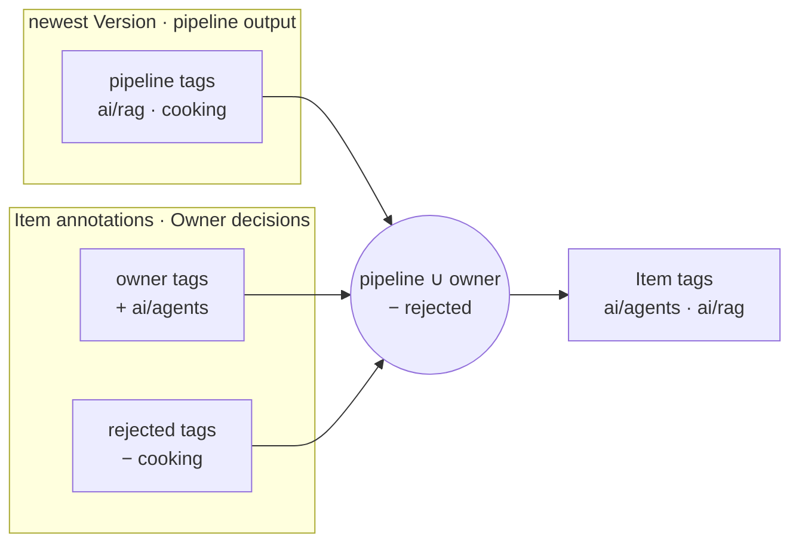
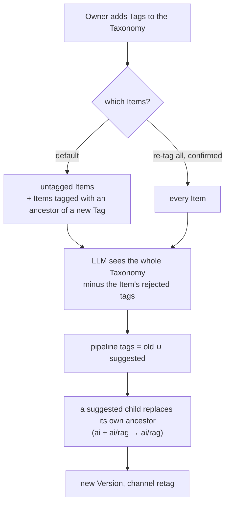

# Tagging model

How an Item gets its tags, and who may change them. Decided 2026-10-05; terms in [CONTEXT.md](../CONTEXT.md).

## Two sources, one result

The pipeline proposes tags; the Owner has the last word. The Owner's decisions live on the Item and survive every new Capture and re-tag.

- **Pipeline tags** are chosen by the LLM from the Taxonomy and stored on the Version (its Enrichment).
- **Owner tags** are picked by hand in the extension or on the Item page.
- **Rejected tags** are tags the Owner took off the Item (an untag). The LLM is never offered them for that Item again.
- The **Item's tags** are what you see, filter and search on: pipeline tags plus owner tags, minus rejected tags.

## What each action does

| Action | Who | LLM call | Pipeline tags | Owner / rejected tags |
|---|---|---|---|---|
| Capture, no tags picked | extension, UI, RSS | tag step | chosen from scratch (rejected tags not offered) | unchanged |
| Capture with tags picked | extension | **none** for tags | empty for this Version | picked tags added to owner tags |
| Re-tag (default) | Taxonomy page | 1 per targeted Item | old ∪ new, a child replaces its own ancestor | unchanged |
| Re-tag all | Taxonomy page, confirmed | 1 per Item | same as re-tag | unchanged |
| Add tag by hand | extension, Item page | none | unchanged | added to owner tags; removed from rejected |
| Untag | Item page | none | unchanged | added to rejected; removed from owner tags |
| Allow again | Item page | none | unchanged | removed from rejected (the tag does not come back by itself) |

Re-tags only ever add. Only a new Capture (new content) or the Owner can make a tag disappear.

## Re-tag

A child replacing its ancestor loses nothing: filtering by `ai` still finds Items tagged `ai/rag`, because a tag filter always includes sub-tags.

## Example

Taxonomy: `ai`, `cooking`; later `ai/rag`, `ai/agents`.

| # | Event | Pipeline | Owner | Rejected | Item tags |
|---|---|---|---|---|---|
| 1 | Captured from the extension, no tags picked | `ai` | | | `ai` |
| 2 | `ai/rag` added; default re-tag reaches the Item (tagged `ai`, the parent). LLM suggests `ai/rag`, `cooking` | `ai/rag` `cooking` | | | `ai/rag` `cooking` |
| 3 | Owner untags `cooking` | `ai/rag` `cooking` | | `cooking` | `ai/rag` |
| 4 | Owner adds `ai/agents` by hand | `ai/rag` `cooking` | `ai/agents` | `cooking` | `ai/agents` `ai/rag` |
| 5 | Page changed and is captured again; tagged from scratch, `cooking` not offered | `ai` | `ai/agents` | `cooking` | `ai` `ai/agents` |
| 6 | Owner allows `cooking` again | `ai` | `ai/agents` | | `ai` `ai/agents` |

## Changing the Taxonomy

| Action | LLM call | Effect on Items and Versions |
|---|---|---|
| Add a Tag | none | none until the next Capture or re-tag |
| Edit a description | none | none; future tag calls see the new text |
| Rename or move a Tag (spelling, not meaning) | none | path rewritten everywhere: sub-tags, Items, owner/rejected tags, past Versions |
| Delete a Tag | none | only allowed while nothing uses it |
